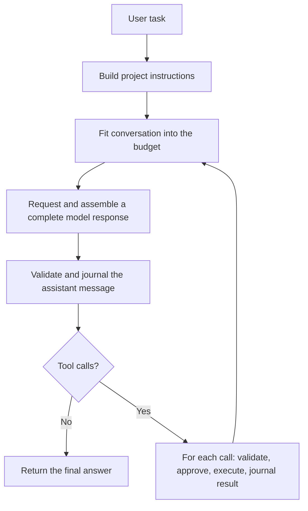

# nano-codex

A small coding agent in Rust for learning **harness engineering**: the program
that turns model responses into useful, controlled work in a codebase. Inspired by
[Codex](https://github.com/openai/codex) and the readable implementation approach
of [nano-vllm](https://github.com/GeeeekExplorer/nano-vllm).

Use this README as a reading map. Start with the loop, follow one tool call through
the code, then study what happens when it fails. Each Rust file covers one concept.
For installation, model connections, and terminal commands, see [USAGE.md](USAGE.md).

## Start with the loop

Open [`src/agent.rs`](src/agent.rs). `run` contains the entire agent loop:

The model proposes actions. The harness decides whether and how to run them.
Denials and tool errors also become results. Each iteration consumes a step;
exhausting `max_steps` stops with an error and a resumable session. A final answer
ends the loop, but the task's tests establish whether the change works.

## Read the code in this order

| Core concept | Implementation | What to look for |
| --- | --- | --- |
| **1. Control loop and stopping** | [`agent.rs`](src/agent.rs), `run` | Request → tool calls → results → next request; sequential execution and the step limit. |
| **2. Conversation state** | [`protocol.rs`](src/protocol.rs), `Message`, `ToolCall`, `Completion` | Call/result IDs, completion validation, and opaque reasoning state that must survive replay. |
| **3. Context construction** | [`context.rs`](src/context.rs), `instructions` and `fit` | Project instructions, stable prefixes, byte budgets, and compaction at complete user-turn boundaries. |
| **4. Tool contracts and authority** | [`tools/schema.rs`](src/tools/schema.rs), [`tools/mod.rs`](src/tools/mod.rs) | Model-facing schemas, typed arguments, approval policy, and errors returned as observations. |
| **5. Workspace operations** | [`tools/files.rs`](src/tools/files.rs), [`tools/paths.rs`](src/tools/paths.rs) | Bounded reads/search, create-only writes, unique-match edits, and path guardrails. |
| **6. Process lifetime** | [`tools/shell.rs`](src/tools/shell.rs), [`main.rs`](src/main.rs) | Concurrent pipe draining, deadlines, process-group cleanup, and Ctrl-C cancellation. |
| **7. Model protocol adapters** | [`provider/mod.rs`](src/provider/mod.rs), [`chat.rs`](src/provider/chat.rs), [`responses.rs`](src/provider/responses.rs) | Translate the same conversation into different wire formats; preserve tool IDs and provider reasoning. |
| **8. Stream assembly** | [`provider/sse.rs`](src/provider/sse.rs), [`response_state.rs`](src/provider/response_state.rs) | Chunks versus events, finalized response items, and the successful terminal event required before execution. |
| **9. Durable state and recovery** | [`session.rs`](src/session.rs), `push`, `record`, `repair_pending` | Persist intent before effects, lock the journal, recover torn records, and mark uncertain calls without rerunning them. |
| **10. Observability and verification** | [`ui.rs`](src/ui.rs), [`examples/demo.py`](examples/demo.py), [`tests/`](tests/) | Text/JSONL events and deterministic end-to-end checks that separate harness behavior from model quality. |

After each row, return to `agent::run` and locate where that responsibility enters
the loop. Keep three things separate as you read: the conversation sent to the
model, the journal used for recovery, and the UI events shown to the user.

For a second pass, use [the failure cases](#learn-the-invariants-by-reading-failure-cases)
to see what each invariant protects.

## Trace one edit through the harness

Follow [`examples/demo.py`](examples/demo.py). It supplies a scripted model over
real HTTP and runs the real CLI against a temporary, buggy `maths.py`.
The [offline walkthrough](USAGE.md#offline-walkthrough) explains how to run it.

1. The scripted model asks to read the file, then proposes `edit_file` to replace
   `return a - b` with `return a + b`. See its `script` and `tool` helper.
2. [`provider/chat.rs`](src/provider/chat.rs) assembles the response into a
   `ToolCall`. Streamed argument fragments are accumulated before execution.
3. [`agent.rs`](src/agent.rs) saves the completed assistant message and its calls
   through `Session::push` **before** invoking any tool.
4. [`tools/mod.rs`](src/tools/mod.rs) deserializes the arguments and enforces the
   configured approval policy. [`files::edit`](src/tools/files.rs) requires one
   exact match; zero or several matches become a tool error.
5. The loop records a `Message::Tool` with the same call ID. The next model request
   includes this observation; it can react to success, denial, or failure.
6. A later `shell` call runs the fixture's tests. Its exit status and output return
   through the same path. A completed answer with no calls ends the task.

The important ordering is **save intent → perform action → save result**. A crash
between the last two steps leaves an uncertain outcome. Resume tells the model
to inspect the workspace; it does not silently repeat the action.

## Learn the invariants by reading failure cases

| Question to investigate | Read the proof |
| --- | --- |
| What if a stream disconnects after a tool call appears complete? | [`tests/cli.rs`](tests/cli.rs), [`tests/response_stream.rs`](tests/response_stream.rs) |
| What if arguments are invalid, an edit is ambiguous, or policy denies execution? | [`tests/tools.rs`](tests/tools.rs) |
| What if a shell fills both pipes, times out, or outlives the CLI? | [`tests/tools.rs`](tests/tools.rs), [`tests/lifecycle.rs`](tests/lifecycle.rs) |
| What if the process dies after a side effect but before saving its result? | [`tests/state.rs`](tests/state.rs), [`session.rs`](src/session.rs) |
| What if history exceeds the budget or a call loses its matching result? | [`tests/state.rs`](tests/state.rs), [`tests/protocol.rs`](tests/protocol.rs) |

The tests use fake servers and temporary workspaces. They establish protocol,
execution, and recovery behavior. Evaluating a model's coding ability additionally
needs tasks with independently checked outcomes.

For deeper explanations and interview questions, continue with
[Harness engineering, through nano-codex](docs/harness-engineering.md). The
[design notes](docs/design.md) explain the tradeoffs and suggest extensions:
task evaluation, bounded parallel reads, better compaction, and OS isolation.
See [CONTRIBUTING.md](CONTRIBUTING.md) before making a change.

## Keep the scope in view

This implementation uses sequential tools, a locked JSONL journal, and deliberately
lossy compaction measured in bytes. An oversized active task stops rather than
losing its tool results. Path checks and approvals provide guardrails; shell
commands run with the user's permissions and **there is no OS sandbox**.

Streaming and stable prompt layout are harness-level latency choices. Speculative
decoding and KV-cache scheduling belong in the connected inference server. This
project has no TUI, MCP, subagents, IDE integration, or full Codex feature parity.

## Supporting infrastructure: read last

[`cli.rs`](src/cli.rs), [`config.rs`](src/config.rs), and [`setup.rs`](src/setup.rs)
handle command syntax, settings, and first-run connection selection.
[`storage.rs`](src/storage.rs) writes private settings atomically.

Login and authentication let the CLI reach a model service; they sit outside the
core harness reading path above. If you want to study that integration afterward,
read [`src/auth/`](src/auth/) and [the authentication notes](docs/authentication.md).
Account setup instructions are at the [end of USAGE.md](USAGE.md#openai-account-access).
