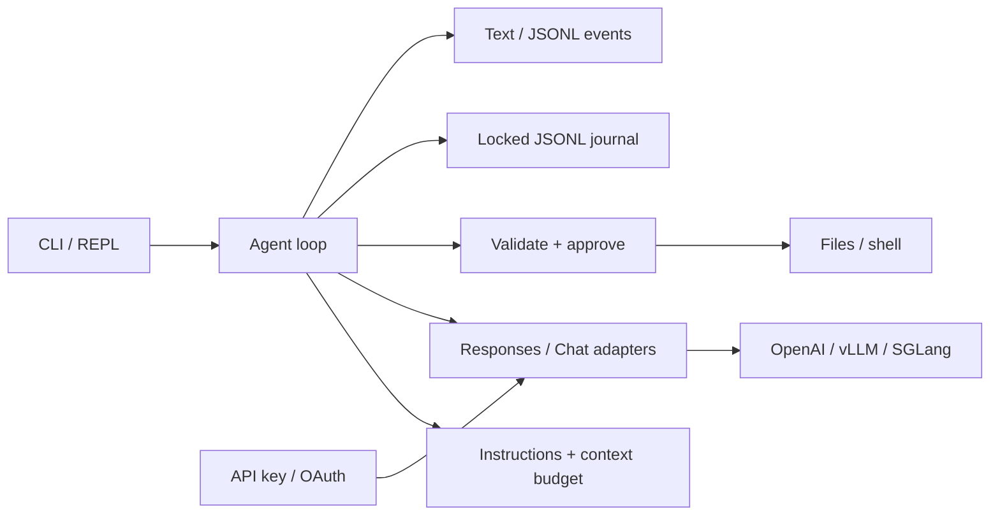

# Design plan

The planning subagent was asked to identify the concepts that matter most for a
small, usable coding-agent harness. This is the resulting implementation scope.

## Priorities

1. **Explicit agent loop.** One owner of conversation state; model turns propose
   calls, tools produce observations, an assistant answer without calls ends a task.
2. **A real execution boundary.** Typed arguments, visible approvals, denied actions
   returned as tool results, bounded output, and process cleanup.
3. **Correct provider contracts.** OpenAI Responses and local Chat Completions have
   separate adapters. Preserve reasoning state and call/result IDs across turns.
4. **Recoverable state.** Persist tool intent before execution. Resume conversations
   without silently rerunning operations whose outcome is unknown.
5. **Context engineering.** Load project instructions, keep a stable prefix, compact
   complete old turns, and make the loss of information explicit.
6. **Authentication and isolation.** Support API keys, documented ChatGPT account
   linking, and independent local-cluster credentials.
7. **Observable, testable behavior.** JSONL events and deterministic fake-server
   tests establish correctness independently of model quality.

## Architecture

There is one crate and no agent framework. Domain types are small. Provider JSON
stays in the wire adapters except opaque Responses output items that must be
replayed unchanged. The model cannot set approvals, choose a workspace, change the
configured endpoint, or directly invoke Rust functions.

## Choices that keep it teachable

- Six tools cover navigation, inspection, editing, and verification. `edit_file`
  uses one unique exact replacement; implementing a general patch parser would add
  substantial code without being necessary to explain the execution boundary.
- Tools run sequentially in model order. This preserves edit-then-test dependencies.
- Sessions use an append-only journal and an exclusive process lock. There is no
  database, background writer, or automatic execution retry queue.
- Compaction is deterministic and lossy. It needs no second model and is easy to
  inspect; the journal retains the original records.
- The terminal UI displays events. It does not own policy or conversation state.
- OAuth is split into flow, token validation/refresh, and storage so security
  concepts remain visible in manageable files.
- Codex account compatibility uses the official login implementation and an
  isolated credential home. Linking an existing account is explicitly read-only;
  credential ownership is recorded as data rather than guessed from its path.
- First-run setup owns connection choices and model discovery. It stores no keys
  and does not change the agent loop.
- Performance mechanisms implemented here are streaming and stable prompt layout.
  Decoder algorithms remain in the connected inference engine.

## Next exercises, in order

1. Add a small task evaluation suite with graded outcomes, budgets, and trace replay.
2. Run consecutive independent reads concurrently, with a strict concurrency bound.
   Preserve order in the transcript and leave mutations sequential.
3. Add model-generated summaries and compare retained facts against excerpt-based
   compaction. Keep the same call/result invariants.
4. Add an OS sandbox, then distinguish approval policy from enforced isolation.
5. Add one MCP stdio server with deadlines and schema validation.
6. Add explicit subagent delegation, separate contexts, and child budgets.

Each extension should be a small, independently understandable change with a
failure-oriented test. A feature should earn its complexity by teaching a concept
or making an ordinary coding workflow work correctly.
